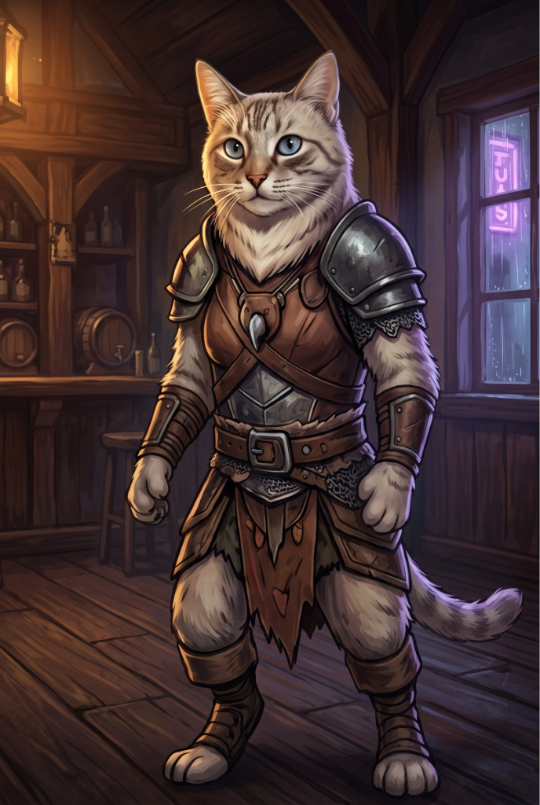
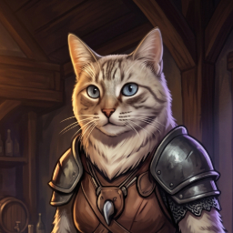

# 01 — Box Art (2.5D Real) — Michi

Generate the high-resolution identity image for **Michi**, then the bust portrait. Box art is the primary identity reference for the south anchor (step 02).





## Approved files

`michi/select.jpg` is the approved box art. Step 02 copies this image. `michi/portrait.jpg` is the approved bust.

The select is 688×1024, a 2:3 portrait (width ÷ height = 0.672). That is the same proportion as `zigo/select.jpg` (687×1024) and `pinduca/select.png`. The portrait is 256×256, the same canvas as `zigo/portrait.jpg`.

What these files lock:

- Feline warrior. Cream and light-grey tabby, white muzzle and chest, bright blue eyes, brown leather and dark metal armor, chainmail at the waist, jagged leather skirt, bare paws.
- Standing still in an empty Gothic tavern. Both paws empty. No axe, no staff, no pink glow, no second character.
- Warm light from the upper left. On the select, rain and one violet neon sign show through the window. The portrait is the same face and armor, cropped to the chest, with the tavern wood behind her.

The weapon stays out until a later pass.

## When to use

- Starting Michi from scratch in the 2.5D pipeline
- Visual anchor for face, armor, palette, and the tavern
- Select first. The portrait copies the approved select, not the alley reference

## Inputs

- **Image 1** — the costume reference (alley, axe, and the other character's staff). It locks face, fur, and armor only.
- Tool: GPT Image 2.0 / Nano Banana 2 / your favorite image model

## Select (copy & paste)

```text
Create a high-resolution character box-art portrait for Michi, a Feline Warrior, for a top-down 2.5D battle game with a flat 2D map.

Image 1 is the costume reference. Keep her face, fur, and armor. Change the pose, the place, and what she holds.

Format:
- 1696x2528 PNG
- 2:3 portrait, the same canvas as the approved Pinduca and Zigo box art
- full-body 3/4 hero composition, head to feet inside the frame
- painted illustration with strong silhouette and readable volume — must translate into pre-rendered 2.5D game sprites

Keep from Image 1:
- Short-haired cream and light-grey tabby cat standing upright and bipedal. Darker tabby stripes on the forehead, cheeks, and ears. White muzzle and chest. Bright blue eyes. Pink nose. The same calm feline face.
- Brown leather cuirass with crossing straps and buckles, dark metal pauldrons, a segmented metal breastplate with a small central point, chainmail at the waist, a jagged brown leather skirt with metal studs, leather bracers, and leather wraps on the lower legs. Bare feline paws on hands and feet.

Change:
- She is standing still, feet planted, weight even. Both paws are empty and relaxed at her sides. Alert, not walking, not lunging.
- No axe, no staff, no weapon, no held object.
- No pink, magenta, or violet magical glow. The only violet light is a neon sign outside the window.

Lighting and volume:
- readable painted shading on the face, leather, and metal
- warm tavern light from the upper left
- a cool violet rim from the window only, on one side of the armor
- grounded feet — she reads as standing on the tavern floor
- no extreme perspective distortion

World/background:
- Empty Gothic tavern at night, in the same antique rainy city as Zigo's rooftops. Dark wood bar, beams, a few mugs and bottles. No patrons, no bartender, no other cats, no people.
- One window shows rain and a single violet neon sign with no readable letters.
- The room supports her, but does not overpower her.

Avoid:
- the axe, the staff, a sword, a bow, or anything in her paws
- pink or magenta light, magical glow, runes, or sparks
- the cropped robed figure from Image 1, or any second character
- a walking stride, a crouch, or a raised fist
- landscape framing or a cropped body
- readable text, logos, UI, watermark
- pure pixel art or SNES-style blockiness
- photorealistic fur strands or hyper-detailed textures
```

## Portrait (copy & paste)

Use this only after the select is approved. **Image 1 is the approved select**, not the alley reference.

```text
Create a character-select bust portrait of Michi, the same Feline Warrior as Image 1.

Image 1 is the approved full-body select. Copy her identity. Do not invent a new outfit or a new face.

Format:
- bust, chest up, the same crop as Zigo's portrait
- she faces the viewer, head and shoulders filling the frame
- painted illustration with readable volume

Keep from Image 1:
- cream and light-grey tabby, white muzzle and chest, darker stripes on the forehead and cheeks, bright blue eyes, pink nose
- the same leather cuirass, metal pauldrons, and breastplate
- the same calm face
- both paws out of frame or empty. No weapon.

Lighting and world:
- the same empty Gothic tavern
- warm light from the upper left, cool violet rim from the window
- rain and one violet neon sign with no readable letters behind her
- no other cats, no people

Avoid:
- full body, the axe, the staff, pink or magenta glow
- a new costume, a hood, a cloak, or a second character
- readable text, logos, UI, watermark
- pure pixel art or photorealistic fur
```

## What Image 1 does not decide

The alley, the walking stride, the axe, the staff, the pink glow, and the cropped figure at the right edge are not Michi. The weapon comes in a later pass.

## Next step

Select and portrait are approved. The south-anchor sketch is [02 — South Anchor](02-south-anchor%20michi.md). It has not been generated.
