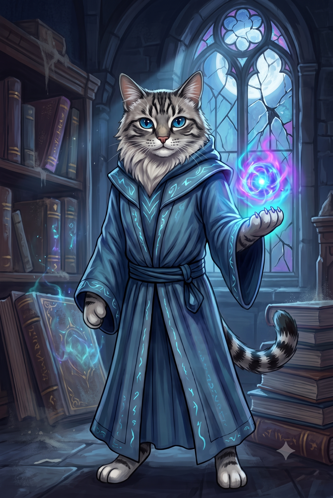

# 01 — Box Art (2.5D Real) — Pinduca

Generate the high-resolution identity image for **Pinduca**. In the **2.5D Real** pipeline, box art is **more central** than in pixel art — it becomes the primary identity reference for the south anchor (step 02).



## When to use

- Starting Pinduca from scratch in the 2.5D pipeline
- Visual anchor for color palette, silhouette, prop, lighting, and personality
- You'll reuse it as **Image 1** in the south anchor step

## Inputs

- Text prompt only (no image references at this stage)
- Tool: GPT Image 2.0 / Nano Banana 2 / your favorite image model

## Prompt (copy & paste)

```text
Create a high-resolution character box-art portrait for Pinduca, a Mystical Feline Mage, for a top-down 2.5D battle game with a flat 2D map.

Format:
- 1024x1536 PNG
- 2:3 portrait
- full-body or near full-body 3/4 hero composition
- painted illustration with strong silhouette and readable volume — must translate into pre-rendered 2.5D game sprites

Character:
- Long-haired grey-and-white tabby cat standing upright bipedal; thick fluffy white ruff around neck and chest; dark grey tabby stripes on forehead, ears, legs, and bushy ringed tail; bright sapphire-blue eyes; pink nose; soft dignified feline face.
- Floor-length deep royal/navy blue hooded wizard robe with the hood resting on her shoulders; matching blue fabric sash tied at the waist; lighter blue V-neck underlayer; cyan/light-blue glowing arcane runes embroidered along sleeve cuffs, front opening, and hem; unarmored feline paws visible.
- Signature prop is magic itself: a compact swirling orb of cyan and violet arcane energy hovering above one open paw. No staff, sword, or physical weapon.
- Calm upright hero pose, intelligent focused gaze, one paw open beneath the floating orb, the other resting naturally at her side; soft cyan-violet light from the orb contrasting her composed demeanor.

Lighting and volume:
- single consistent light source from top-left
- soft but readable shading on face, robe folds, white ruff, and tabby fur stripes
- subtle rim light from the orb on paw and robe hem — keep it gentle, not a full VFX blast
- grounded feet — character reads as standing on a flat surface
- no extreme perspective distortion

World/background:
- Dim antique Gothic library tower at night — tall dusty bookshelves, stacked leather-bound tomes, cobwebs, moonlight through a cracked arched leaded window.
- same world language as the rest of the roster
- background supports the character, but does not overpower them

Avoid:
- text, logos, UI, watermark
- symbols/runes/glyphs except the intentional cyan rune trim on her robe
- background motifs that belong to another character
- pure pixel art or SNES-style blockiness
- photorealistic skin pores, individual fur strands, or hyper-detailed textures
```

## Notes from the Pinduca run

Keep the cyan glowing rune trim on the robe — it is part of her identity (unlike the wizard example where runes were stripped). Match grey/silver tabby fur, white ruff, sapphire eyes, and deep navy robe from `pinduca/pinduca-box1.png`. That file is the approved box art. `pinduca/pinduca-box2.png` was not used and now lives in `old/pinduca/`.

In 2.5D, box art **feeds step 02** — pick a variant with clean top-left lighting and a silhouette that still reads when scaled down. Keep baked-in magic minimal on the orb here; dynamic cast VFX belong in the attack sheet (step 06).

## Next step

→ [02 — South Anchor](02-south-anchor%20pinduca.md)
