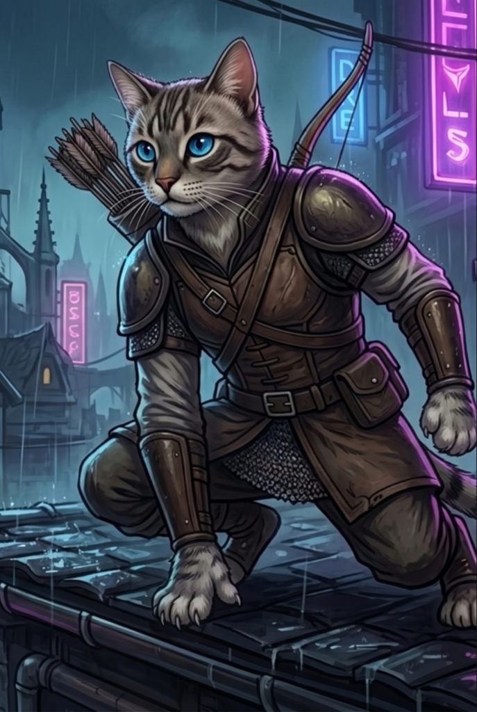

# 01 — Box Art (2.5D Real) — Zigo

Generate the high-resolution identity image for **Zigo**. In the **2.5D Real** pipeline, box art is **more central** than in pixel art — it becomes the primary identity reference for the south anchor (step 02).



## When to use

- Starting Zigo from scratch in the 2.5D pipeline
- Visual anchor for color palette, silhouette, prop, lighting, and personality
- You'll reuse it as **Image 1** in the south anchor step

## Inputs

- Text prompt only (no image references at this stage)
- Tool: GPT Image 2.0 / Nano Banana 2 / your favorite image model

## Prompt (copy & paste)

```text
Create a high-resolution character box-art portrait for Zigo, a Feline Rogue, for a top-down 2.5D battle game with a flat 2D map.

Format:
- 1696x2528 PNG
- 2:3 portrait, the same canvas as the approved Pinduca box art
- full-body 3/4 hero composition
- painted illustration with strong silhouette and readable volume — must translate into pre-rendered 2.5D game sprites

Character:
- Short-haired cream and light-grey tabby cat, bipedal; dark brown tabby stripes on forehead, cheeks, and ears; a ringed cream tail; white muzzle and chest; bright cyan-blue eyes; pink nose; alert feline face.
- Brown leather rogue kit: fitted vest with a diagonal chest strap and buckle, metal pauldrons on both shoulders, leather bracers, a belt with a buckle and a side pouch, and a short chainmail hem. Pale shirt sleeves under the leather. Dark trousers. Bare feline paws on hands and feet.
- A wooden recurve bow slung on his back, upper limb rising above one shoulder. A quiver of fletched arrows on his back, over the other shoulder. Both paws empty. The bow is not in his hands and no arrow is on the string.
- Low crouch on a wet rooftop ledge: one paw planted forward on the tiles, the other held near the waist, one knee bent, the other leg extended back. Watchful gaze.

Lighting and volume:
- readable painted shading on face, leather, and tabby stripes
- night rain, with cool moonlight and a violet-cyan rim from the alley signs
- paws planted on the wet tiles
- no extreme perspective distortion

World/background:
- Wet Gothic rooftop at night in the same antique city as the library tower — slate tiles, pipes along the ledge, chimneys, distant spires, rain, overhead cables, and cyan and magenta neon signs.
- background supports the character, but does not overpower them

Avoid:
- landscape framing or a cropped body
- the bow in his paws, drawn to his face, or an arrow on the string
- boots, cloak, hood, or a second character
- pure pixel art or SNES-style blockiness
- photorealistic skin pores, individual fur strands, or hyper-detailed textures
```

## Approved file

`zigo/select.jpg` is the approved box art. Step 02 copies this image: the low crouch, the bow on the back, and both paws empty.

The file is 687×1024 JPEG, a 2:3 portrait (687 ÷ 1024 = 0.671). That is the same proportion as `pinduca/pinduca-box1.png` (1696×2528).

## Next step

→ [02 — South Anchor](02-south-anchor%20zigo.md)
